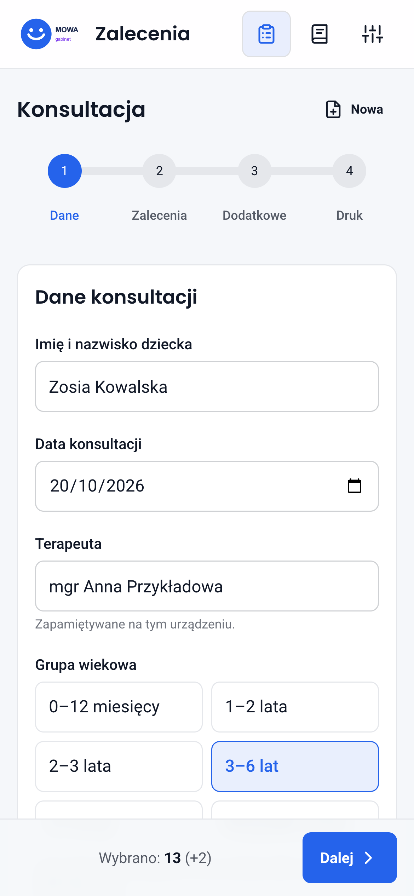
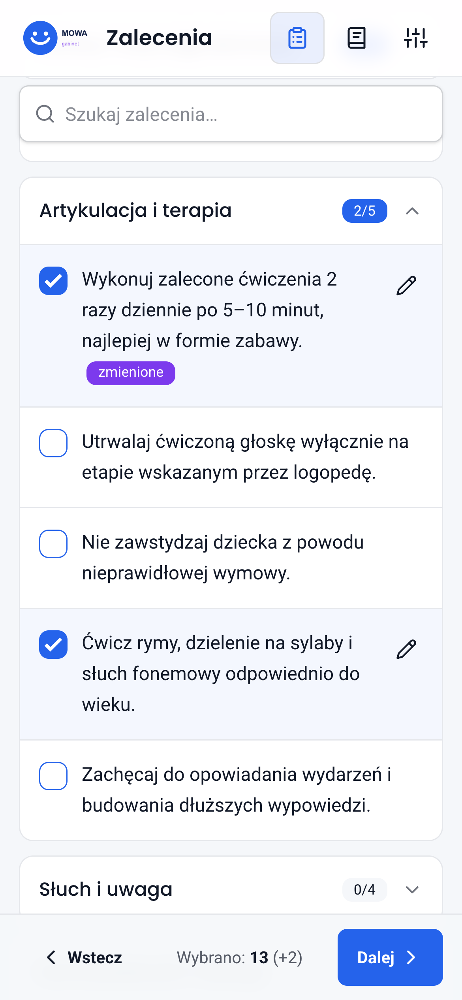
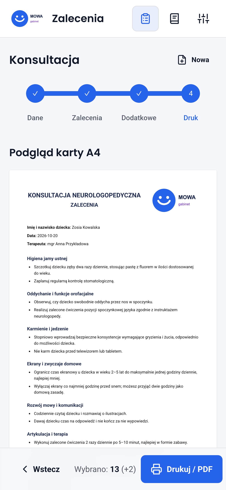
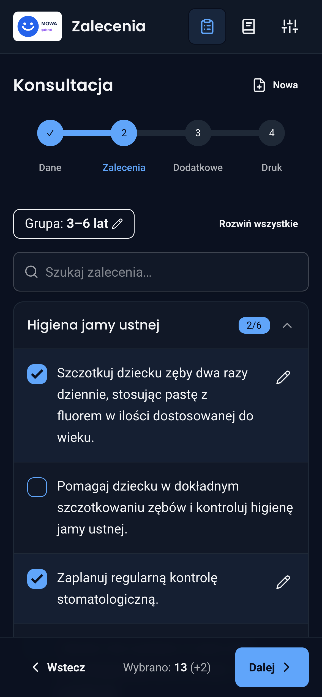
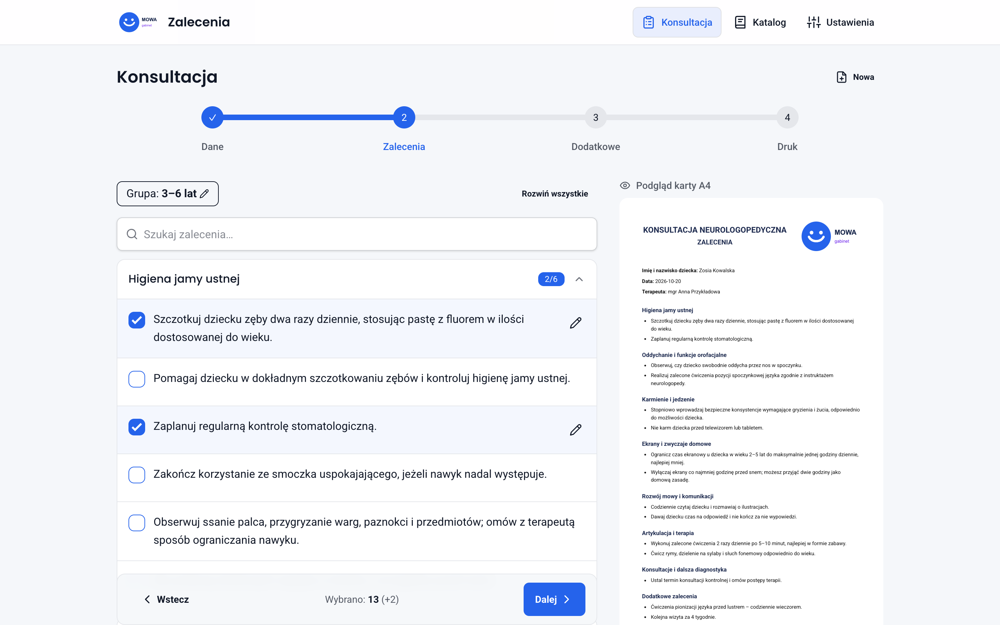
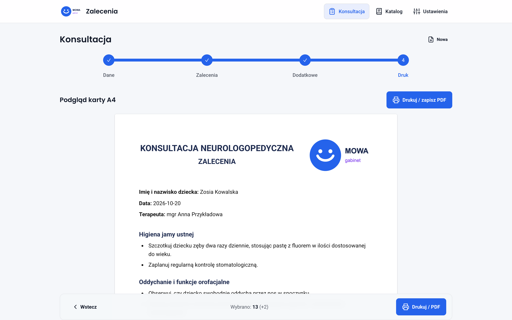
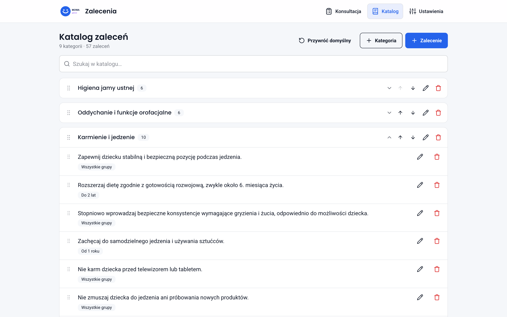
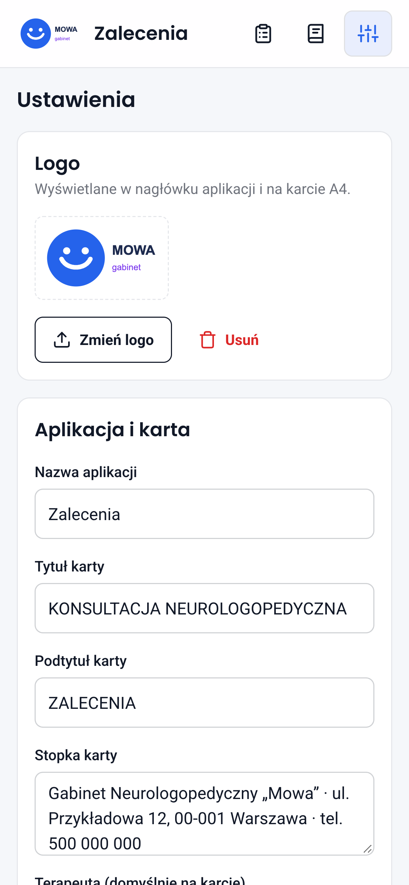

# Zalecenia

Offline-first PWA for creating printable neurological speech therapy recommendation cards for children.

**Live app: [zalecenia-app.vercel.app](https://zalecenia-app.vercel.app/)**

The app runs entirely in the browser — there is no backend. All data (catalog, settings and the
current consultation draft) is stored only in the device's `localStorage`. The user interface is in Polish.

## Screenshots

<p>
  
  
  
  
</p>









All data shown in the screenshots (names, logo, address) is fictional.

## Features

- **Consultation wizard** (4 steps: details → recommendations → extra → print)
  - child's name, date, therapist (remembered) and age group
  - recommendation list filtered by age group, with search
  - per-print text edits of selected recommendations, without changing the catalog
  - extra one-off recommendations for the current card
  - the draft survives page reloads until "New consultation" clears it; no consultation history is kept
- **A4 card printing** via the browser print dialog ("Save as PDF"), with logo, signature line and footer
- **Editable catalog** — add, edit, delete and reorder categories and recommendations (drag & drop or arrows),
  optional age tag per recommendation, restore defaults
- **Settings** — logo, app name, card title/subtitle, footer, signature line
- **Export / import** — JSON file with the catalog and/or settings
- **PWA** — installable, works offline, prompts when a new version is available
- Mobile-first layout, light and dark theme (follows the system setting)

## Tech stack

Vue 3 · Vite · Pinia · Vue Router · Tailwind CSS 4 · daisyUI 5 · vite-plugin-pwa · Vitest

## Getting started

```bash
npm install
npm run dev        # http://localhost:5173
npm test           # unit tests (Vitest)
npm run build      # production build to dist/
npm run preview    # serve the build with the service worker (offline testing)
```

During development, `http://localhost:5173/tools/devices.html` shows the app in a phone-sized frame
(query parameters: `?path=/katalog`, `&dark=1`).

## Deployment (Vercel)

Import the repository in Vercel and keep the **Vite** framework preset (build command `npm run build`,
output directory `dist`). `vercel.json` provides the SPA rewrite and cache headers for `sw.js` and `assets/`.

## Project structure

| Path | Description |
|---|---|
| `src/data/seedCatalog.js` | default recommendation catalog (seed data) |
| `src/data/ageGroups.js` | age groups and tag mapping (`all`, `baby`, `1+`, `2+`, `3+`, `2-5`) |
| `src/stores/` | Pinia stores: `catalog`, `settings`, `draft` (current consultation), `ui` |
| `src/views/` | Consultation (wizard), Catalog, Settings |
| `src/components/PrintCard.vue` | A4 card — the same component is used for the preview and for printing |
| `src/lib/transfer.js` | JSON export / import |
| `src/styles/main.css` | daisyUI "clean" theme (light/dark) and print styles |

### Age groups

| Age group | Visible tags |
|---|---|
| 0–12 months | `all`, `baby` |
| 1–2 years | `all`, `baby`, `1+` |
| 2–3 years | `all`, `1+`, `2+`, `2-5` |
| 3–6 years | `all`, `1+`, `2+`, `3+`, `2-5` |
| 6–12 years | `all`, `1+`, `2+`, `3+` |
| All groups | all tags |

## Export file format

```json
{
  "app": "zalecenia",
  "version": 1,
  "exportedAt": "2026-10-20T12:00:00.000Z",
  "catalog": [
    { "id": "…", "name": "Category", "items": [{ "id": "…", "text": "…", "age": "all" }] }
  ],
  "settings": {
    "appName": "…", "cardTitle": "…", "cardSubtitle": "…", "footer": "…",
    "showSignature": true, "signatureLabel": "…", "logo": "data:image/png;base64,…", "therapist": "…"
  }
}
```

Both `catalog` and `settings` are optional. Importing replaces the sections present in the file.

## Privacy

Patient data is never sent anywhere. The only stored patient data is the current consultation draft
on the device, which is removed with "New consultation".
